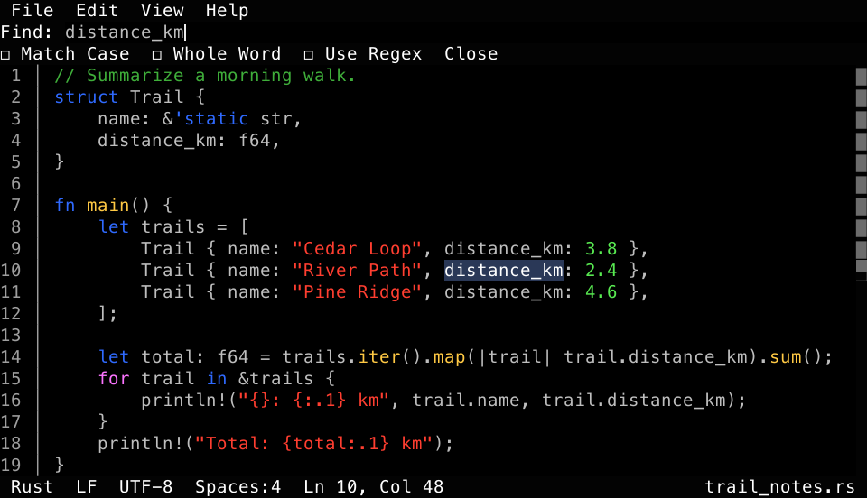

# RustyEdit

RustyEdit is an independent fork of [Microsoft Edit](https://github.com/microsoft/edit), a terminal text editor inspired by the MS-DOS Editor, but with a little more modern TUI. The executable is named `edit`.



Use **File → Open Recent** to reopen one of the last 10 files you opened. The list is stored locally and is available when you restart RustyEdit.

## Installation

Build from this checkout with Rust and a C compiler:

```sh
cargo install --locked --git https://github.com/KwisatzJim/RustyEdit edit
edit --version
```

## Build Instructions

* [Install Rust](https://www.rust-lang.org/tools/install)
* Clone the repository
* If you're using nightly Rust:
  ```sh
  cargo build --release --config .cargo/release.toml
  ```
* If you're using stable Rust:
  * Ideally: Set the environment variable `RUSTC_BOOTSTRAP=1` and use the **nightly** build instructions above.
    This is recommended, because it drastically reduces the binary size and slightly improves performance.
  * Otherwise, simply run:
    ```sh
    cargo build --release
    ```

### Build Configuration

You can set the following environment variables at build-time to configure the build:

Environment variable | Description
--- | ---
`EDIT_CFG_ICU*` | See [ICU library name (SONAME)](#icu-library-name-soname) below for details. Linux package maintainers are advised to review and configure these options.
`EDIT_CFG_LANGUAGES` | A comma-separated list of languages to include in the build. See [i18n/edit.toml](i18n/edit.toml) for available languages.

#### ICU library name (SONAME)

RustyEdit uses ICU for Find and Replace. Set these environment variables at build time if your installation uses different library names.

| Variable | Windows default | macOS default | Linux and other Unix defaults |
| --- | --- | --- | --- |
| `EDIT_CFG_ICUUC_SONAME` | `icuuc.dll` | `libicucore.dylib` | `libicuuc.so` |
| `EDIT_CFG_ICUI18N_SONAME` | `icuin.dll` | `libicucore.dylib` | `libicui18n.so` |

- Set `EDIT_CFG_ICU_CPP_EXPORTS=true` if ICU exports symbols with a leading underscore, such as `_u_errorName`.
- Set `EDIT_CFG_ICU_RENAMING_VERSION` to the export version if symbols have a version suffix, such as `u_errorName_76`.
- Set `EDIT_CFG_ICU_RENAMING_AUTO_DETECT=true` to detect the suffix at runtime. Use either auto-detection or an explicit version. Auto-detection is enabled by default on Linux and other Unix targets excluding macOS when no ICU overrides are set.
